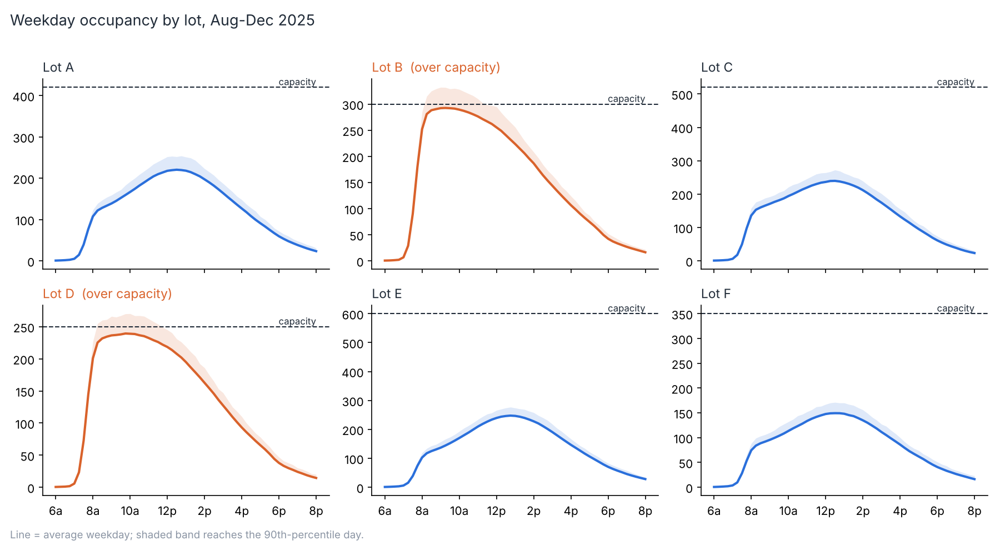
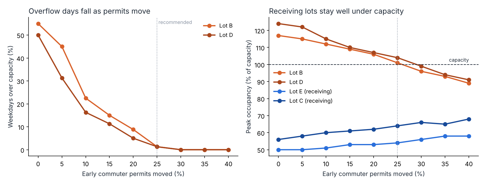

# Campus parking demand analysis

> **Personal project.** All parking scan data is synthetic.

Uses a semester of permit gate scans to find which campus lots overflow, when, and the smallest policy change that fixes it.

## The finding

Lots **B and D** ran over capacity on about half of all weekdays, mostly before 10 a.m. Meanwhile Lots **C and E** never passed 56% full. Simulation shows that moving **25%** of early commuter permits from B and D to C and E cuts overflow days from ~50% to ~1%. The receiving lots stay under 65% full.





## Run it

```bash
python -m venv .venv && source .venv/bin/activate
pip install -r requirements.txt
python run.py          # ~35 seconds: generate, load SQLite, run SQL, simulate
python -m pytest -q    # 3 tests, including an exact-count check of the SQL
```

Outputs land in `outputs/`: `SUMMARY.md`, `parking.db` (open it in DB Browser for SQLite), CSVs and charts.

## How it works

1. **Generate** ~190,000 parking sessions over Aug 25 to Dec 12, 2025 (`src/generate_data.py`). Includes realistic gaps: ~0.4% of sessions never scan out.
2. **Clean**: drop sessions missing a scan-out or with an exit before entry, and report how many.
3. **Load into SQLite** with an index on `(lot, day)`.
4. **SQL does the analysis** (`sql/`):
   - `occupancy.sql` builds a 15-minute time grid with a recursive CTE, then counts parked cars per slot with a range join.
   - `overflow_summary.sql` ranks lots by how often and how badly they overflow.
5. **Simulate the pilot**: move 0–40% of early commuter permits, re-run the same SQL each time, and pick the smallest share that gets overflow under 5% of days.

## Interview talking points

- **Why a time grid instead of counting scans?** Scans tell you arrivals. Occupancy needs arrivals *and* departures, so each slot counts cars where entry ≤ slot < exit.
- **Why the 90th-percentile band?** Average days look fine for Lot D. Bad days are what students complain about.
- **Why sweep the share instead of picking one?** It shows the committee the trade-off curve, and the smallest change that works is easiest to approve.

## Limitations

- When a lot is full, real drivers are turned away, so counts above capacity represent *demand*, not actual cars.
- The simulation assumes moved permit holders keep their arrival times and stay lengths.
